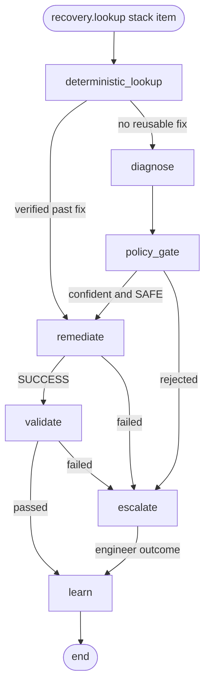

# Recovery agent: the LangGraph loop (LG1)

Coordinates the recovery of one failure from Deterministic Lookup through Learn and
keeps the state of every recovery workflow.

```
lookup/ service --> kafka: recovery.lookup --> recovery-agent --> one LangGraph workflow per failure
                                                    |
                                                    +-- SQLite checkpoints (volume agent-state)
```

**This is the skeleton.** The graph, its routing, the saved state and the Kafka
consumer are real. The steps after the lookup are stubs that change nothing and
fail closed, so today every failure ends `ESCALATED`. Each stub is replaced by its
own task:

| Node | File | Built in | Stub behaviour |
|---|---|---|---|
| `deterministic_lookup` | `nodes/deterministic_lookup.py` | here | real: reads the lookup verdict, sets the route |
| `diagnose` | `nodes/diagnose.py` | Task 103 | proposes nothing, confidence 0 |
| `policy_gate` | `nodes/policy_gate.py` | Task 103 | rejects everything |
| `remediate` | `nodes/remediate.py` | Task 104 | executes nothing, reports `NOT_IMPLEMENTED` |
| `validate` | `nodes/validate.py` | Task 105 | does not pass |
| `escalate` | `nodes/escalate.py` | Task 106 | records why it was escalated, asks nobody |
| `learn` | `nodes/learn.py` | Task 107 | writes nothing to Neo4j |

## The graph (`graph.py`)



`python -m agent.graph` prints the diagram of the graph as compiled, and a test
checks these edges.

**A step that raises does not stop the agent.** The graph retries it
(`AGENT_NODE_MAX_ATTEMPTS`, default 3, waiting `AGENT_NODE_RETRY_SECONDS` and then
twice as long). If it still raises, the error is saved in `error` and the failure
goes to Escalate with reason `STEP_FAILED`. This is also why `deterministic_lookup`
and `diagnose` have an edge to `escalate` that the diagram leaves out. If Escalate
or Learn itself keeps raising, the workflow ends with status `FAILED`. Because of
the retry, **a step must be safe to run more than once**.

## State of a workflow (`state.py`)

One workflow handles one item of a `recovery.lookup` stack. Each node returns only
its own keys:

| Written by | Keys |
|---|---|
| consumer | `lookup_id`, `failure_id`, `failure`, `lineage_context`, `incident_context`, `priority`, `lookup_route`, `route_reason` |
| `deterministic_lookup` | `route`, `action` (when a past fix is reused) |
| `diagnose` | `diagnosis` = `{hypothesis, confidence, proposed_action}` |
| `policy_gate` | `policy` = `{passed, reasons}`, and `action` when it passes |
| `remediate` | `execution` = `{status: SUCCESS or FAILED, ...}` |
| `validate` | `validation` = `{passed, reasons}` |
| `escalate` | `escalation` = `{status, reason, details}`, `status` |
| `learn` | `learned`, `status` |
| every node | one `trace` entry, so the path can be read back |
| a stub | its name in `stubbed`. Delete that line when you build the step |
| the graph | `error` = `{node, error, attempts}` when a step kept raising |

`action` (`{action, action_params, source, incident_id}`) is the only thing Remediate
executes. Only two nodes may set it: `deterministic_lookup` (a fix that already
worked) and `policy_gate` (a proposal that passed both checks). A diagnosis alone
never reaches Remediate.

To build a step, rewrite its function in `agent/nodes/` so it returns the keys
above. The routing in `graph.py` does not need to change.

## How state is kept (`consumer.py`)

LangGraph saves the state after every node in SQLite, under
`thread_id = failure.failure_id`. For each stack item the agent does one of:

- **new**: no saved state, start the workflow.
- **resumed**: the workflow stopped part-way (the agent was killed): continue from
  the last finished node. Nodes that already ran are not run again.
- **duplicate**: the workflow ended and every step it went through was real: skip
  it. Kafka delivers at least once.
- **rerun**: the workflow ended on a stub (`stubbed` is not empty). Nothing was
  really done, so the saved state is dropped and the failure runs again.

The Kafka offset is committed after the whole stack was handled. While a stack is
being worked the agent pauses the partition and polls Kafka after every workflow,
so a long stack does not get it dropped from the consumer group.

### Failures seen while steps are still stubs

A failure that passes through today ends `ESCALATED` on the stubs, and nobody is
told. It is not lost for good: it stays `PENDING` in `silver2_quarantine`, and
because of **rerun** it is handled properly the next time it is published. After a
step is built, publish the open failures again by resetting the scanner:

```bash
docker compose rm -sf lookup-scanner
docker volume rm self-healing-pipeline_lookup-state
docker compose up -d lookup-scanner
```

## Run it

```bash
docker compose up -d --build recovery-agent
docker compose logs -f recovery-agent
```

```
[agent] lookup 2b3075d8-...: 2 failure(s)
[agent] 618007b08d401166 new       P2 Crash1:crash_month value='Jule' -> ESCALATED (deterministic_lookup > remediate > escalate > learn) [stubs: remediate, escalate, learn]
[agent] e5f15f5f6c77b874 new       P3 Crash1:weather_condition value='misty dark' -> ESCALATED (deterministic_lookup > diagnose > policy_gate > escalate > learn) [stubs: diagnose, policy_gate, escalate, learn]
```

The first word is the `failure_id`. Print everything saved for that workflow:

```bash
docker compose exec recovery-agent python -m agent.show 618007b08d401166
```

Settings (`config.py`): `LOOKUP_OUTPUT_TOPIC`, `AGENT_CONSUMER_GROUP`,
`AGENT_CHECKPOINT_PATH`, `AGENT_MAX_POLL_INTERVAL_MS`, `AGENT_NODE_MAX_ATTEMPTS`,
`AGENT_NODE_RETRY_SECONDS`. To start from empty state,
remove the volume: `docker compose rm -sf recovery-agent && docker volume rm self-healing-pipeline_agent-state`.

## Tests

No Kafka or Neo4j needed. From the repo root:

```bash
pip install -r agent/requirements.txt pytest
python -m pytest agent
```
