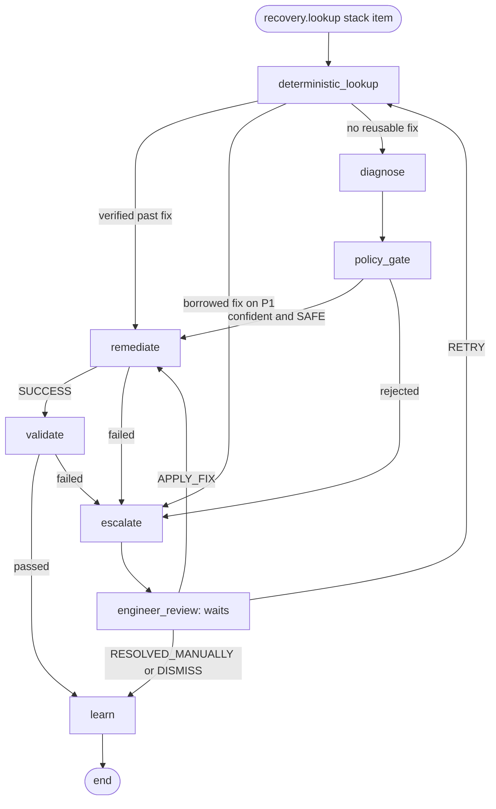

# Recovery agent: the LangGraph loop (LG1)

Coordinates the recovery of one failure from Deterministic Lookup through Learn and
keeps the state of every recovery workflow.

```
lookup/ service --> kafka: recovery.lookup --> recovery-agent --> one LangGraph workflow per failure
                                                    |   ^
                                                    |   +-- kafka: recovery.decisions <-- python -m agent.review (engineer)
                                                    +-- SQLite checkpoints (volume agent-state)
                                                    +-- Neo4j incidents + ref_canonical_mappings (Learn)
```

Every step is real. A fix that passes the gate is staged and audited by Remediate,
replayed and checked by Validate, and its records are released into Silver 2.
Everything else is handed to an engineer: the workflow pauses with the whole case
saved, and continues with the engineer's decision. **Learn** stores every outcome as
an incident in Neo4j, so the next occurrence is found by the Deterministic Lookup,
and promotes proven fixes into `ref_canonical_mappings`, so Silver 2 maps the value
itself from then on. Each step was built by its own task:

| Node | File | Built in | Behaviour today |
|---|---|---|---|
| `deterministic_lookup` | `nodes/deterministic_lookup.py` | Task 102 | real: reads the lookup verdict, sets the route |
| `diagnose` | `nodes/diagnose.py` | Task 103 | real: asks the reasoning model for a cause and one fix |
| `policy_gate` | `nodes/policy_gate.py` | Task 103 | real: confidence threshold, safe-action set and a check against the records |
| `remediate` | `nodes/remediate.py` | Task 104 | real: idempotency check, stages the fix, writes the audit record |
| `validate` | `nodes/validate.py` | Task 105 | real: replays the staged records through Silver 2, checks them, releases them |
| `escalate` | `nodes/escalate.py` | Task 106 | real: opens a case for an engineer with the full context |
| `engineer_review` | `nodes/engineer_review.py` | Task 106 | real: waits for the engineer's decision and acts on it |
| `learn` | `nodes/learn.py` | Task 107 | real: stores the incident in Neo4j, promotes proven variants |

## The graph (`graph.py`)



`python -m agent.graph` prints the diagram of the graph as compiled, and a test
checks these edges.

**A step that raises does not stop the agent.** The graph retries it
(`AGENT_NODE_MAX_ATTEMPTS`, default 3, waiting `AGENT_NODE_RETRY_SECONDS` and then
twice as long). If it still raises, the error is saved in `error` and the failure
goes to Escalate with reason `STEP_FAILED`. This is also why `deterministic_lookup`
and `diagnose` have an edge to `escalate` that the diagram leaves out. If Escalate,
`engineer_review` or Learn itself keeps raising, the workflow ends with status
`FAILED` (a broken Escalate goes straight to Learn: there is no case to wait on). Because of
the retry, **a step must be safe to run more than once**.

## State of a workflow (`state.py`)

One workflow handles one item of a `recovery.lookup` stack. Each node returns only
its own keys:

| Written by | Keys |
|---|---|
| consumer | `lookup_id`, `failure_id`, `failure`, `lineage_context`, `incident_context`, `priority`, `lookup_route`, `route_reason` |
| `deterministic_lookup` | `route`, `action` (when a past fix is reused) |
| `diagnose` | `diagnosis` = `{status, hypothesis, confidence, proposed_action, model, allowed_actions, evidence, reasons}` |
| `policy_gate` | `policy` = `{passed, outcome, reasons, checks, threshold, unverified_threshold, safe_actions}`, and `action` when it passes |
| `remediate` | `execution` = `{status: SUCCESS or FAILED, execution_id, action, action_params, source, target_table, overlay, rows_expected, rows_affected, rows_with_other_failures, sample_record_ids, quarantine_version, executed_at, idempotent_replay, audit, reasons}` |
| `validate` | `validation` = `{status: PASSED or FAILED, passed, reasons, checks, execution_id, target_table, column, canonical_value, rows_staged, rows_valid, rows_remaining, rows_released, rows_already_released, crash_date, quarantine_version, validated_at}` |
| `escalate` | `escalation` = `{status: WAITING, escalation_id, round, reason, details, case, escalated_at, decision: None, history}`, `status` = `ESCALATED` |
| `engineer_review` | `escalation` with `status: DECIDED` and `decision`, `status`, and for `APPLY_FIX` the engineer's `action` (`source: ENGINEER`) |
| `learn` | `learned` = `{status: STORED or SKIPPED, written, incident_id, outcome, resolved_by, verified, borrowed, embedded, embed_error, attempts, promotion, learned_at}`, `status` |
| every node | one `trace` entry, so the path can be read back |
| a stub | its name in `stubbed` (no step is a stub any more; tests still use the mechanism) |
| the graph | `error` = `{node, error, attempts}` when a step kept raising |

`action` (`{action, action_params, source, incident_id}`) is the only thing Remediate
executes. Only three nodes may set it: `deterministic_lookup` (a fix that already
worked), `policy_gate` (a proposal that passed both checks) and `engineer_review` (a
fix an engineer decided, with `approved_by`). A diagnosis alone never reaches
Remediate.

Final `status` of a workflow: `RESOLVED` (fixed and validated without an engineer),
`RESOLVED_BY_ENGINEER` (an engineer's fix that validated, or fixed by hand),
`DISMISSED` (the engineer decided not to fix it), `FAILED` (a last step kept raising).
While a case is open the status is `ESCALATED`.

To build a step, rewrite its function in `agent/nodes/` so it returns the keys
above. The routing in `graph.py` does not need to change.

## Diagnose (`nodes/diagnose.py`, spec AP1)

Runs only for failures the lookup could not match to a verified past fix.

1. **Retrieve.** The lineage and the nearest past incidents were read from Neo4j by
   the Deterministic Lookup and arrive in the state (`lineage_context`,
   `incident_context`). Diagnose adds two things from the pipeline's Delta tables
   (`reference.py`, read only, no Spark): the column's canonical values from
   `ref_canonical_mappings`, and up to `DIAGNOSE_SAMPLE_RECORDS` quarantined records
   that carry the failure, as they looked in Silver 1. The records are what lets the
   model tell `Jule` = June from `Jule` = July: the `crash_date` is in the same row.
2. **Generate.** Everything is merged into one JSON context and sent to the reasoning
   model (`llm.py`: Qwen on Ollama, `/api/chat`, temperature 0). The answer is held to
   a JSON schema built for this failure: `action` can only be one of the actions that
   apply to it, `canonical_value` only one of the column's canonical values.
3. **Check the shape.** A reply with a missing hypothesis, an action that was not
   offered or a confidence outside 0..1 is not a diagnosis.

`diagnosis.status` says what happened:

| Status | Meaning | Proposal |
|---|---|---|
| `OK` | the model answered in the asked form | one action with parameters |
| `SKIPPED` | a mandatory field is empty, there is nothing to interpret; no model call | `ESCALATE` |
| `UNAVAILABLE` | Ollama not reachable, model not pulled, or timed out | none |
| `INVALID_OUTPUT` | the model answered something else than the JSON asked for | none |

Diagnose never raises and never sets `action`. With no model running, every new
failure is escalated with the reason `no usable diagnosis (UNAVAILABLE)`. A model
that is down or times out is a result, not an exception, so the graph's retry of a
raising step never repeats a 120 s model call.

Qwen3 thinks before it answers unless told not to, and the thinking counts against
`DIAGNOSE_NUM_PREDICT`, so a long one cuts the JSON off (`INVALID_OUTPUT`: "reply was
cut off"). The request therefore carries `think: false` (`DIAGNOSE_THINK`). A model
without a thinking mode that refuses the field is asked once more without it.

Check the model once before relying on it, and again after changing `DIAGNOSE_MODEL`:

```bash
docker compose exec recovery-agent python -m agent.check_model
```

It sends one fixed example (`Jule` in three records dated in June) through the real
Diagnose and gate, prints the diagnosis, the gate's verdict and the time it took, and
exits 0 when the model answered in the asked form. It needs only Ollama.

Text in the data (a raw value, a past diagnosis) is passed as data only, cut to 300
characters, and the system prompt tells the model not to follow it. That is a
request, not a guarantee, which is one reason the gate below trusts nothing the
model writes.

## Actions and the safe set (`actions.py`, spec AP2)

The model can only propose an action from this list. `Safe` means the policy gate
may let it run without an engineer:

| Action | Offered for | `action_params` | Safe | Why |
|---|---|---|---|---|
| `ADD_VARIANT` | a value failure on a column that has canonical values | `{"canonical_value": "JULY"}` | yes | Tried as an in-memory overlay on the quarantined rows of this failure only. The rows stay in quarantine unless Validate passes, and the mapping reaches `ref_canonical_mappings` only through Learn's promotion. |
| `RENAME_COLUMN` | a schema failure with missing and unexpected columns | `{"renames": {"CrashDate": "crash_date"}}` | no | Changes how every later batch of the table is read, not only the failed records. |
| `ESCALATE` | every failure | `{}` | no | Not a fix: the model asks for an engineer. |

To make another action safe, change `actions.py` in a reviewed PR. The setting
`POLICY_SAFE_ACTIONS` can only narrow the set (`NONE` sends every diagnosis to an
engineer); it cannot add to it.

A past fix reused by the Deterministic Lookup does not pass the gate below: it was
already validated or approved by an engineer. **Except on a P1 failure:** a fix
borrowed from a similar incident (`matched_by` `STRUCTURED` or `EMBEDDING`, not
`EXACT`, e.g. `Jule` fixed in Crash1 and now seen in Crash3) waits for an engineer's
approval before it runs (escalation reason `APPROVAL_REQUIRED`; `approve` runs it
through Remediate and Validate). Thay chose this on 2026-11-14: P1 has the widest
impact and Validate cannot tell a wrong value outside month and weekday. The tiers
are `APPROVE_BORROWED_FIX_TIERS` (default `P1`, `NONE` or `ALL`). Once approved and
learned, the same value is an exact match and is not asked again. A borrowed fix that
ran without approval (P2/P3) is learned as `borrowed`, so an exact match on it is still
asked on P1 (see Learn). It is still checked against the failure
with the gate's own `parameters` check (`actions.check_params`) before it becomes
`action`, so a fix whose canonical value has since left `ref_canonical_mappings`, or
that does not fit this failure, is sent to Diagnose instead of to Remediate.

## Policy gate (`nodes/policy_gate.py`, spec AP2, AP3, RS1)

Deterministic, no model. The proposal becomes `action` only when every check passes:

| Check | Passes when |
|---|---|
| `safe_action` | the action is in the safe set (spec condition 1) |
| `confidence` | the model's confidence is at least `POLICY_CONFIDENCE_THRESHOLD`, default 0.85 (spec condition 2) |
| `trusted_failure` | the failure itself is not waiting for review (a Qwen classification with `needs_review`) |
| `parameters` | the parameters fit the failure: the canonical value exists for that column (read again from `ref_canonical_mappings`, not taken from the diagnosis), a rename uses the failure's own column names |
| `evidence` | `ADD_VARIANT` only: the quarantined records do not contradict the value, see below |
| `not_tried_before` | the same fix has not already failed for this failure (`incident_context.previous_attempts`) |

The last four only ever turn a pass into an escalation. On a pass, `action_params` is
rebuilt from the checked values: nothing else the model wrote reaches Remediate.

### Evidence: is the value right, not only valid? (`evidence.py`)

A confident model can be wrong, and `parameters` only proves that the value exists.
For two columns the record itself carries the answer, so the gate reads the failure's
sample records from quarantine again (all of `sample_record_ids`, not the three shown
to the model) and compares:

| Column | Must agree with |
|---|---|
| `crash_month` | the month of `crash_date` |
| `crash_day_of_week` | the weekday of `crash_date` |

| What the records say | Result |
|---|---|
| at least one decides the value, all for the proposal | passes at the normal threshold |
| at least one rules the proposal out (`Jule` proposed as JULY, `crash_date` in June) | rejected, whatever the confidence |
| nothing decides: another column (weather, lighting, ...), or no readable date | passes only at `POLICY_UNVERIFIED_CONFIDENCE_THRESHOLD` (0.95), where the model's confidence is all there is. `NEVER` sends all of these to an engineer. |

A date like `04/07/2019` is read both ways (7 April or 4 July) because the order
depends on the source folder. It confirms a month only when both readings agree or
only one is a real date (`22/06/2024`), but it still rules out every other month.

This narrows the gap, it does not close it. The gate sees a handful of sample
records, so agreement across every record of the failure stays Validate's check
(Task 105), and both thresholds are uncalibrated until the evaluation (Task 111).

### What the gate writes

`policy.outcome` says what happened, `policy.checks` lists every check with its
result and `policy.reasons` the ones that failed:

| `outcome` | Meaning |
|---|---|
| `PASSED` | every check passed; the proposal is now `action` |
| `REJECTED` | a fix was proposed and a check stopped it |
| `ENGINEER_REQUESTED` | Diagnose itself proposed `ESCALATE` (the evidence did not single out a fix, or a mandatory field is empty); no fix was blocked |
| `NO_DIAGNOSIS` | there was nothing to judge: model unreachable or its reply unusable |

Escalate uses it for the escalation's `reason`: `POLICY_GATE_REJECTED` only for
`REJECTED`, and `ENGINEER_REQUESTED` or `NO_DIAGNOSIS` for the other two, so an
engineer does not read a model asking for help as a blocked fix.

## Remediate (`nodes/remediate.py`, spec RD1, RD2, RD3, TA2)

Runs for an `action` that came from the policy gate or from a reused past fix, in
the fixed order of the spec:

1. **Idempotency check.** `execution_id` is a hash of the failure, the action and
   its parameters. If the audit table already holds a `SUCCESS` for that id, this
   exact fix was executed before: the recorded result is returned
   (`idempotent_replay: true`) and nothing runs again. This is what protects a
   workflow that resumes at Remediate because the agent stopped after executing but
   before LangGraph saved the node, a step the graph retries because it raised, and
   a failure that is run again because a later step was still a stub. A `FAILED` attempt staged nothing, so it does
   not block the fix: if the same fix comes back (a resumed workflow, or a later
   retry once the cause is gone) it runs again. If the audit table cannot be read,
   nothing is executed.
2. **Execute.** The executor of the action (`executors.py`), see below.
3. **Audit record.** One row in the audit table for every attempt, failed ones too.
   `SUCCESS` is claimed only after that row is committed.

Remediate never raises. Everything that is not `SUCCESS` goes to Escalate with
`execution.reasons`: an action with no executor, parameters that no longer fit, a
reference table or quarantine that cannot be read (reported as that, not as a wrong
value), no record left to fix, records of the group that cannot be found, an audit
record that cannot be written.

### What executing `ADD_VARIANT` means (`executors.py`)

It **stages** the fix, it does not release it:

- The parameters are checked again against `ref_canonical_mappings`: the table may
  have changed since the policy gate or `deterministic_lookup` checked them, and a
  workflow can resume here much later.
- The failure's group is collected from `silver2_quarantine`: every record still
  waiting (`PENDING` or `IN_PROGRESS`) with the same folder, column and raw value
  (trimmed, upper-cased), from the micro-batches the failure was found in. These are
  exactly the rows the scanner grouped into the failure. The batches are the union
  of `batch_id` and `evidence.quarantine_batches`, because a failure the lookup
  merged from two publishes can carry the full list in only one of them.
- The group is staged whole or not at all. Rows already `RESOLVED` are accounted
  for, but if fewer rows are found than the failure reported, the execution fails:
  a fix applied to part of a group would leave the rest in quarantine with nobody
  looking for it.
- The overlay `{"crash_month": {"JULE": "JULY"}}` is built. It is the shape
  `ref_mappings.overlay_mappings()` takes, so Validate can apply it on top of the
  reference table when it re-runs `standardize_silver2` on the staged records.

Nothing in Silver 2, the quarantine or `ref_canonical_mappings` changes here: the
only write is the audit record. A wrong fix is therefore undone by discarding the
staged group, which is what makes the action safe. The records reach Silver 2 only
after Validate passes, and the mapping reaches the reference table only through
Learn's promotion (Task 107).

`RENAME_COLUMN` has no executor: even as a verified past fix it fails here and goes
to an engineer. A test checks that every safe action has an executor.

### The audit table (`audit.py`, `delta/remediation_audit`)

A Delta table written without Spark, one row and one commit per execution attempt.
An `execution_id` can have several `FAILED` rows and one `SUCCESS`. Only the agent
writes it; Spark and `verify_delta.py remediation_audit` can read it.

| Column | Meaning |
|---|---|
| `execution_id` | idempotency key: hash of failure, action and parameters |
| `failure_id`, `lookup_id` | the workflow it belongs to (`python -m agent.show <failure_id>`) |
| `action`, `action_params` | what was executed, parameters as JSON |
| `action_source`, `incident_id`, `confidence` | `DIAGNOSIS` with the model's confidence, or `INCIDENT` with the past incident |
| `status`, `reasons` | `SUCCESS`, or `FAILED` with why |
| `target_table`, `column_name`, `raw_value` | where the failure is |
| `overlay` | the staged mapping, as JSON |
| `rows_expected`, `rows_affected` | rows the failure reported, rows staged |
| `rows_with_other_failures` | staged rows that also fail another column, so they stay quarantined after this fix |
| `record_ids` | the affected records |
| `quarantine_version` | Delta version of the quarantine that was read |
| `started_at`, `executed_at` | execution timestamp (UTC) |

The row is the only thing Remediate writes and it is one Delta commit, so the
staged group and its audit record cannot exist without each other.

```bash
docker compose exec recovery-agent python -m agent.audit                  # latest 20 executions
docker compose exec recovery-agent python -m agent.audit <execution_id>   # its attempts, with record ids
docker compose exec recovery-agent python -m agent.audit <failure_id>
```

### What the next tasks take from it

- **Validate (105)** reads the staged group from the audit record:
  `audit.find(execution["execution_id"])` gives all `record_ids`, the `overlay` and
  the `target_table` (the state keeps only five sample ids). See the next section.
- **Escalate (106)** gets `execution.reasons` for a failed execution. An engineer's
  fix is executed here like any other, with `action_source = ENGINEER`.
- **Pipeline cleanups (109)**: Remediate does not change `healing_status`. It accepts
  rows the trigger has marked `IN_PROGRESS` and never stages a `RESOLVED` row.

## Validate (`nodes/validate.py`, spec VD1 to VD4)

Runs after a `SUCCESS` from Remediate. It works on the whole group Remediate staged
(VD1), not on the sample in the state, and has four steps:

1. **The group.** `audit.find(execution_id)`: every staged `record_id`, the overlay
   `{column: {RAW: canonical}}` and the `target_table` (`silver2_crash3`).
2. **Replay** (`replay.py`, VD2). The agent starts one small local Spark session the
   first time it validates and keeps it. The staged rows are read from
   `silver2_quarantine` (on `record_id` + `target_table`, whatever their status) and
   their `raw_record`, the untouched Silver 1 row, goes once through the pipeline's
   own `silver2_job.standardize_silver2`, with `ref_canonical_mappings` plus the
   overlay (`ref_mappings.overlay_mappings`). Nothing is re-implemented: the image
   carries `spark-jobs/common.py`, `sources.py`, `ref_mappings.py` and
   `silver2_job.py` and the same pyspark / delta-spark versions. Each source is read
   in its own date order (`DAY_FIRST_SOURCES`), so Crash3's `04/07/2021` is 4 July
   here exactly as in the Silver 2 job. The mapping is not promoted for this.
3. **Checks** (`validation.py`, VD3). All are computed and listed in
   `validation.checks`, also after one fails:

   | Check | Passes when |
   |---|---|
   | `resolution` | the overlay is exactly the approved fix, and the value is a canonical value of the column in `ref_canonical_mappings` |
   | `no_conflicting_mapping` | the raw value is not already mapped to a different canonical value (the table may have changed since the gate) |
   | `rows_conserved` | every staged record is found exactly once, nothing else resolved it in the meantime, none is already in Silver 2, and staged = valid + still quarantined |
   | `targeted_resolved` | the targeted column no longer fails in **any** staged record, and its standardized value is the canonical value |
   | `no_new_failures` | no record fails a column it did not fail before |
   | `agrees_with_crash_date` | `crash_month` / `crash_day_of_week` only: the value is the month / weekday of the standardized `crash_date` of **every** record that has one. One June record among fifty July ones stops `JULE -> JULY`. This is the agreement across rows the gate could only check on samples. |

4. **Release**, only when every check passed. Records with nothing left to fix are
   appended to the source's Silver 2 table, exactly the columns the Silver 2 job
   writes, so Gold streams them like any other row. Then their quarantine rows are
   set to `healing_status = RESOLVED` with `resolved_by` (the execution id) and
   `resolved_at`, two columns the agent adds to the quarantine the first time.
   A record that still fails another column (counted in `rows_remaining`) stays
   `PENDING` for that other failure.

A passed validation goes to Learn, anything else to Escalate with reason
`VALIDATION_FAILED` and the failed checks as details (VD4). A fix that does not
hold is a result, not an exception. Spark or Delta failing to read or write raises,
so the graph retries the step and then escalates it as `STEP_FAILED`.

**Running it again is safe.** The replay changes nothing. The Silver 2 append uses
`txnAppId = recovery_agent_release:<execution_id>`, so Delta skips it if it already
landed, and the quarantine update only touches rows still waiting. If the agent
stops between the append and the update, the next run sees the transaction in
Silver 2, skips the append and marks the rows. Records this execution already
released are counted in `rows_already_released`, not written again.

What it does not do (later tasks):

- It does not promote `JULE -> JULY` into `ref_canonical_mappings`; that is Learn's
  decision. Until the variant is promoted a record that also failed another column
  can only be released once both fixes are known together: when its other failure is
  fixed, that failure's overlay does not carry this one, so the record stays
  quarantined. Once it is promoted, the replay tool releases such records.
- It does not write to Neo4j (Learn). A fix that does not hold goes to an engineer
  (Escalate).

The writes go to the source's `silver2_<source>` and to `silver2_quarantine`, from
the agent's own Spark session, next to the Silver 2 job's streaming appends. Delta
handles the two writers (appends do not conflict, and a conflicting quarantine
update or schema change is retried).

One agent consumes `recovery.lookup`: the service has a fixed `container_name`, so
Compose refuses to scale it. Two agent processes working on the same failure at the
same moment (a `docker compose run` next to the service) could both pass the
idempotency check and both write a `SUCCESS` row. Nothing else is written, and
every reader takes the first row, so they agree on one result; if the agent is ever
scaled out on purpose, the check needs a lock. The table gets one small file per
attempt, which is fine for the number of failure groups here and would need
compaction at a much larger scale.

## Escalate and the engineer (`nodes/escalate.py`, `nodes/engineer_review.py`, spec EL1)

Every failure the agent cannot fix safely ends with an engineer, never with nobody.
Escalate opens a **case** and the workflow then pauses in `engineer_review` until the
engineer decides. Pausing is LangGraph's `interrupt()`: the state is saved in the
checkpoints, the agent goes on with the next failure, and a restart loses nothing.

**Why it was escalated** (`escalation.reason`, from the step that sent it):

| Reason | Sent by | Means |
|---|---|---|
| `POLICY_GATE_REJECTED` | policy gate | a fix was proposed and a check stopped it (`details`: the failed checks) |
| `ENGINEER_REQUESTED` | policy gate | Diagnose itself proposed `ESCALATE` |
| `NO_DIAGNOSIS` | policy gate | the model was unreachable or its reply unusable |
| `GATE_PASSED_WITHOUT_ACTION` | policy gate | should not happen; fails closed |
| `REMEDIATION_FAILED` | Remediate | the fix could not be staged (`execution.reasons`) |
| `VALIDATION_FAILED` | Validate | the staged fix did not hold (the failed checks) |
| `STEP_FAILED` | any step | it kept raising (`error`) |
| `APPROVAL_REQUIRED` | deterministic_lookup | a reused past fix that must be approved before it runs |

**The case** (`escalation.case`, `agent/escalation.py: build_case`) is what the spec
asks for instead of a bare alert: the failure (table, column, raw value, rows,
batches), its priority, blast radius and downstream tables, the three closest past
incidents and earlier failed attempts, the model's hypothesis, confidence and
proposal, the failed checks of the gate or Validate, Remediate's reasons, up to
`DIAGNOSE_SAMPLE_RECORDS` sample records, the column's canonical values, and the
**proposed fix**: the one that was about to run or failed, otherwise the one the
gate stopped (none when the model asked for an engineer).

### Deciding (`python -m agent.review`)

```bash
docker compose exec recovery-agent python -m agent.review                  # open cases, highest priority first
docker compose exec recovery-agent python -m agent.review show <failure_id>   # the case (--json for all of it)
docker compose exec recovery-agent python -m agent.review approve  <failure_id> --by thay
docker compose exec recovery-agent python -m agent.review fix      <failure_id> JUNE --by thay
docker compose exec recovery-agent python -m agent.review retry    <failure_id> --by thay
docker compose exec recovery-agent python -m agent.review resolved <failure_id> --by thay --note "fixed the source file"
docker compose exec recovery-agent python -m agent.review dismiss  <failure_id> --by thay --note "OTHER has no canonical value yet"
```

| Command | Decision | What the workflow does |
|---|---|---|
| `approve` | `APPLY_FIX` with the proposed fix | Remediate stages it, Validate replays, checks and releases it, Learn stores it with status `RESOLVED_BY_ENGINEER` and promotes the variant at once |
| `fix VALUE` | `APPLY_FIX` `ADD_VARIANT` with the engineer's canonical value | same |
| `approve` / `fix` with `--no-promote` | same, `promote: false` | the records are healed, the variant is **not** added to `ref_canonical_mappings` (and the agent never promotes it by recurrence either) |
| `retry` | `RETRY` | runs the automated path again from `deterministic_lookup` (Ollama or a table was down) |
| `resolved` | `RESOLVED_MANUALLY` | nothing is executed; Learn gets `RESOLVED_BY_ENGINEER` and the note |
| `dismiss` | `DISMISS` | nothing is executed, the records stay quarantined; Learn gets `DISMISSED` and the note |

An engineer's fix gets no shortcut: it is staged, audited (`action_source = ENGINEER`)
and validated like the model's. If it does not hold, the failure comes back as a new
**round** (`f1:2`) with the new reason, and the earlier rounds stay in
`escalation.history`. `RENAME_COLUMN` has no executor yet, so a schema fix is applied by
hand and closed with `resolved`.

`--by` (or `ENGINEER_NAME`) is required and recorded; `resolved` and `dismiss` need a
note, because Learn stores it as the outcome. The command checks the decision against
the saved case before it sends anything: the round must be the open one, a value must
be a canonical value of the column (read again from `ref_canonical_mappings`). It then
publishes to Kafka `recovery.decisions`; it never runs the workflow itself, so the
agent stays the only writer of the checkpoints. The agent checks the decision again
and resumes the workflow, and its log shows the result:

```
[agent] decision APPLY_FIX by thay on 289b9d3430ea286e:1: decided
[agent] 289b9d3430ea286e decided  P3 crash1:crash_month value='Jule' -> RESOLVED_BY_ENGINEER (... > escalate > engineer_review > remediate > validate > learn)
```

A decision for a workflow that is not waiting, or for an older round, is refused and
logged; the workflow keeps waiting. If `engineer_review` itself refuses a decision the
agent had accepted (the reference table changed or could not be read in between), the
log says `refused`, and `review list` / `show` mark the case with the refused decision
and why, so nobody believes it is being applied.

After a fix fails Validate, the proposed fix is that same fix: `approve` would replay
the staged execution and fail the same way, so `show` hides it and `approve` refuses
unless `--force` is given. Use `fix VALUE` for another value.

**Assumption: whoever can write to `recovery.decisions` is trusted.** The topic is not
authenticated and `--by` is free text, so any process that reaches Kafka can apply a
fix in someone's name, and the audit and the workflow record that name as
`approved_by`. That is acceptable for this project's single-host setup; a real
deployment would need Kafka ACLs on the topic or signed decisions. A decision delivered again after the agent died
while acting on it continues the workflow; delivered again after it finished, it is a
duplicate. The agent creates both topics at start, so the first decision is not
delayed by Kafka's metadata refresh.

`escalation.decision` = `{decision, engineer, note, escalation_id, decided_at}` and,
for `APPLY_FIX`, `action`, `action_params` and `promote`. An `APPLY_FIX` that reached
Learn passed Validate, so it is approved by an engineer and Learn promotes it at once
(spec EL2) unless `promote` is false. Each round in `escalation.history` keeps the
`proposed_fix` it was about, so Learn can store a fix that failed Validate.

## Learn (`nodes/learn.py`, `promotion.py`, spec EL2, EL3, KG2, TA3)

The last step of every workflow that has an outcome, automated or human. Validate has
already released the healed records; Learn keeps what was learned. Three parts:

**1. The outcome, as an incident in Neo4j** (`agent/memory/incidents.py:
write_incident`, schema in `lineage/schema.cypher`). One per workflow, with
`incident_id = failure_id`, so writing it again updates it:

| Workflow ended | outcome | action | resolved_by | verified | reused by the lookup |
|---|---|---|---|---|---|
| `RESOLVED`: a fix passed Validate without an engineer | `SUCCESS` | the fix | `LLM` (Diagnose) or `LOOKUP` (reused) | yes | yes |
| `RESOLVED_BY_ENGINEER`: `approve` / `fix` that passed Validate | `SUCCESS` | the fix | `ENGINEER` | yes | yes |
| `RESOLVED_BY_ENGINEER`: `resolved` (fixed by hand) | `SUCCESS` | `MANUAL` | `ENGINEER` | yes | no: shown as a past incident, the note says what was done |
| `DISMISSED` | `DISMISSED` | `DISMISS` | `ENGINEER` | no | no: listed as a previous attempt |
| `FAILED` (nobody decided) | nothing is stored | | | | |

A fix that was staged and **failed Validate** in an earlier round is stored too, as
`<failure_id>:attempt:<round>` with outcome `FAILED_VALIDATION` (unless the same fix
held later). The lookup never reuses a fix that failed for the same signature.

Each incident carries its provenance: `failure_id`, `execution_id`, `batch_ids`
(`silver2_crash1:7`), `fix_source`, `matched_by` and `reused_incident_id` for a reused
fix, `approved_by`, `engineer_note`, `escalation_reasons`, `priority_tier` and the
promotion decision. It is embedded with the lookup's model and text
(`incidents.signature_text`, `LOOKUP_EMBED_MODEL`, off by default); an unreachable model
only leaves the vector out (`learned.embed_error`), the exact and structured lookups
still find it.

**Borrowed fixes stay borrowed** (Thay's rule of 2026-11-14 for P1). A fix the lookup
reused from a similar incident, not an exact one, that no engineer approved (P2/P3 run
it directly) is stored with `borrowed = true`. When a later failure matches that
incident exactly, the lookup still reports it as borrowed (`match.borrowed`) and
`deterministic_lookup` asks for approval on P1 as for any borrowed fix, so reusing a
borrowed fix never turns it into an exact one. `find_exact` prefers a fix that is not
borrowed. Once an engineer approves it, the incident is not borrowed.

**2. Promotion into `ref_canonical_mappings`** (`promotion.py`, EL2). The variant
(column, RAW value, canonical value) is the overlay Validate checked. It is added:

- **at once** when an engineer's fix passed Validate (`approve`, `fix`, including an
  approved borrowed fix). `--no-promote` heals the records only.
- **when it recurs**: the same fix of the same value, made by the agent, has healed at
  least `PROMOTE_MIN_OCCURRENCES` rows (default 5) in at least `PROMOTE_MIN_BATCHES`
  distinct micro-batches (default 3), each validated (Thay, 2026-11-14). Batches are
  counted per source table (`silver2_crash1:7` and `silver2_crash3:7` are two).
  Borrowed fixes nobody approved do not count. `NEVER` in either setting leaves
  promotion to engineers.

And **never** when the value is ambiguous: another verified incident fixed the same
signature to a different value (`Ju` was JUNE in one batch and JULY in another), or
the table already maps the raw value to something else. While there is doubt (the same
fix failed Validate before, or an engineer declined promoting it) only the automatic
promotion waits; an engineer approving this very fix overrides it
(`learned.promotion.overridden`). Only `ADD_VARIANT` is promoted.

The lookup applies the same rule to reuse: when the verified fixes of one exact value
disagree (`find_exact` returns them in `distinct_fixes`), neither is reused, and the
failure goes to Diagnose with both as past incidents.

The write is a Delta MERGE on `(field_name, raw_synonym)` that only inserts (the same
key as the Silver 2 job's own fuzzy promotion), done with `deltalake`, without Spark:
`added_by = recovery_agent:engineer:<name>` or `recovery_agent:recurrence`,
`source_batch_id = recovery_agent:<incident_id>`, `confidence = 1.0`. Silver 2 reloads
the table every micro-batch, so the next occurrence of the value is standardized there
and never reaches quarantine. The decision is in `learned.promotion` = `{status:
PROMOTED | ALREADY_IN_TABLE | BELOW_THRESHOLD | BLOCKED | DECLINED | NOT_APPLICABLE,
route: ENGINEER_APPROVED | RECURRENCE, reasons, occurrences, batches, needed, inserted}`
and on the incident (`promotion`, `promotion_reason`, `promoted`).

Learn does not release quarantined records. Records that were still waiting for the
promoted value, e.g. a record that also failed another column and stayed `PENDING`
after Validate, are released by re-running them against the updated table with the
replay tool (Task 108, `tools/replay.py quarantine`).

**3. When Neo4j or the table is down**, Learn raises; the graph retries it and then
ends the workflow `FAILED` with `error.node = learn`. Everything Learn writes is
idempotent, and the agent runs Learn alone again (**relearn**, below) every
`AGENT_RELEARN_INTERVAL_SECONDS` (300) until it succeeds, and at once if the failure is
delivered again. The scanner does not publish a failure twice, so the timer is what
normally retries it. At start the agent looks through every saved workflow for one
that still needs Learn.

Look at what was stored in the Neo4j browser (http://localhost:7474):

```cypher
MATCH (i:Incident)-[:AFFECTS]->(t:Table)
RETURN i.signature_key, i.outcome, i.action, i.action_params, i.resolved_by, i.borrowed,
       i.promotion, i.batch_ids, t.name ORDER BY i.resolved_at DESC LIMIT 25
```

and what was promoted: `added_by` starting with `recovery_agent:` in `ref_canonical_mappings`.

## How state is kept (`consumer.py`)

LangGraph saves the state after every node in SQLite, under
`thread_id = failure.failure_id`. For each stack item the agent does one of:

- **waiting**: the workflow is paused for an engineer: leave it. Only the
  engineer's decision continues it, not a new publish of the failure.
- **new**: no saved state, start the workflow.
- **resumed**: the workflow stopped part-way (the agent was killed): continue from
  the last finished node. Nodes that already ran are not run again.
- **duplicate**: the workflow ended and every step it went through was real: skip
  it. Kafka delivers at least once.
- **rerun**: the workflow ended on a stub (`stubbed` is not empty), so it was not
  really finished: the saved state is dropped and the failure runs again. **Except**
  a workflow an engineer decided (`escalation.decision` set, or status
  `RESOLVED_BY_ENGINEER` / `DISMISSED`): that is a duplicate (or relearned, below),
  never rerun, so the engineer is not asked again and a released fix is not redone. A
  fix Remediate staged the first time is not executed twice, its idempotency check
  finds the audit record and returns it.
- **relearn**: the workflow ended and only Learn is missing: Learn kept raising
  (Neo4j or the reference table was down; the status is `FAILED` with
  `error.node = learn`), or it ended on the Learn stub before Task 107. Learn alone
  runs again, from the checkpoint saved just before it, so no fix, model call or
  engineer's case is repeated. The status becomes the real one again. The agent also
  does this on its own, without a redelivery: at start for every saved workflow that
  needs it, and every `AGENT_RELEARN_INTERVAL_SECONDS` for those still failing.

The Kafka offset is committed after the whole stack was handled. While a stack is
being worked the agent pauses the partition and polls Kafka after every workflow,
so a long stack does not get it dropped from the consumer group.

### Failures seen while steps were still stubs

A failure that went through a stub ended without its outcome being stored. It is not
lost for good: the next time it is published it is handled properly. A workflow that
only missed Learn (every workflow finished between Task 106 and Task 107, including
cases an engineer already closed) is **relearned**: only Learn runs, nobody is asked
again, and the agent does this on its own at start. A workflow an engineer decided is
never rerun from the start. One that went through an earlier stub is **rerun**. To
publish the failures again, reset the scanner:

```bash
docker compose rm -sf lookup-scanner
docker volume rm self-healing-pipeline_lookup-state
docker compose up -d lookup-scanner
```

## Run it

```bash
docker compose up -d --build recovery-agent
docker compose logs -f recovery-agent
```

```
[agent] lookup 66b035e5-...: 2 failure(s)
[agent] fd95d1c4c9991007 new       P3 crash1:crash_month value='Jule' -> RESOLVED (deterministic_lookup > diagnose > policy_gate > remediate > validate > learn)
[agent] 289b9d3430ea286e new       P3 crash1:weather_condition value='MISTY DARK' -> ESCALATED POLICY_GATE_REJECTED, waiting for an engineer: python -m agent.review show 289b9d3430ea286e (deterministic_lookup > diagnose > policy_gate > escalate)
```

The first failure passed the gate, was staged by `remediate`, held in `validate`,
its records were released into Silver 2 and `learn` stored it as an incident; the
second was stopped by the gate and waits for an engineer (`python -m agent.review`).
A path that ends `remediate > escalate` is a failed execution, `validate > escalate`
a fix that did not hold. The first validation waits about 10 s for Spark to start. Diagnose needs Ollama with the model
pulled (`ollama pull qwen3:8b`); without it both lines end at `policy_gate > escalate`.

The first word is the `failure_id`. Print everything saved for that workflow:

```bash
docker compose exec recovery-agent python -m agent.show fd95d1c4c9991007
```

Settings (`config.py`): `LOOKUP_OUTPUT_TOPIC`, `AGENT_DECISIONS_TOPIC`, `AGENT_CONSUMER_GROUP`,
`AGENT_CHECKPOINT_PATH`, `AGENT_MAX_POLL_INTERVAL_MS`, `AGENT_NODE_MAX_ATTEMPTS`,
`AGENT_NODE_RETRY_SECONDS`, `APPROVE_BORROWED_FIX_TIERS` (`P1`), Learn's (see the Learn
section: `PROMOTE_MIN_OCCURRENCES`, `PROMOTE_MIN_BATCHES`, `NEO4J_*`, `LOOKUP_EMBED_MODEL`,
`AGENT_RELEARN_INTERVAL_SECONDS`),
and for Diagnose and the gate:

| Setting | Default | Meaning |
|---|---|---|
| `DIAGNOSE_MODEL` | `qwen3:8b` | reasoning model, any model Ollama serves (`ollama pull` it first) |
| `DIAGNOSE_BASE_URL` | `http://host.docker.internal:11434` | Ollama |
| `DIAGNOSE_TIMEOUT_SECONDS` | `120` | one model call |
| `DIAGNOSE_SAMPLE_RECORDS` | `3` | quarantined records shown to the model, 0 for none |
| `DIAGNOSE_THINK` | `false` | `false` = answer directly, `true` = think first (raise `DIAGNOSE_NUM_PREDICT`), `default` = leave it to the model |
| `POLICY_CONFIDENCE_THRESHOLD` | `0.85` | minimum confidence to run without an engineer, 0.5 to 1 |
| `POLICY_UNVERIFIED_CONFIDENCE_THRESHOLD` | `0.95` | minimum confidence when no record can confirm the value; 0.5 to 1 and never below the threshold above, or `NEVER` |
| `POLICY_SAFE_ACTIONS` | empty | empty = the safe set of `actions.py`; `NONE` anywhere in the list = review everything |

A threshold outside its range (0, 85, a typo) is refused: the agent stops at start
with the reason in its log instead of running with a gate that passes everything.

Compose passes `DIAGNOSE_MODEL`, `DIAGNOSE_BASE_URL`, `DIAGNOSE_THINK` and the three
`POLICY_` settings from `.env` (see `.env.example`). The model's context and reply
size are `DIAGNOSE_NUM_CTX` (8192) and `DIAGNOSE_NUM_PREDICT` (1024).

`REMEDIATION_AUDIT_PATH` (`/data/delta/remediation_audit`) is the audit table.
Compose mounts `./delta` writable: the agent writes the audit table, the healed rows
of `silver2_<source>`, the status of their quarantine rows and the promoted variants
of `ref_canonical_mappings`, and only reads the rest. Validate's settings: `DELTA_ROOT` (where `silver2_<source>` is),
`DAY_FIRST_SOURCES` (must match the Silver 2 job, Compose passes the same default),
`VALIDATE_SPARK_DRIVER_MEMORY` (`512m`) and `VALIDATE_SPARK_MASTER` (`local[2]`).
The Spark session adds roughly 1 to 1.5 GB to the agent's memory once it has started.

To start from empty state, remove the volume:
`docker compose rm -sf recovery-agent && docker volume rm self-healing-pipeline_agent-state`.
The audit table is kept, so a failure that comes back is still not executed twice.

The agent's memory is in three places: the workflows in the `agent-state` volume, the
executions in `delta/remediation_audit` and the incidents in Neo4j (`neo4j-data`).
When you reset the pipeline by deleting `delta/` and `checkpoints/`, the audit table
and the promoted variants go with it, so remove the `agent-state` volume in the same
step (command above). Otherwise the reprocessed data produces the same failure ids
and the agent skips them as workflows it has already finished. The incidents survive
in Neo4j: past fixes are still reused, and the promotion counts carry on. To forget
them too: `docker compose exec neo4j cypher-shell -u neo4j -p selfhealing "MATCH (i:Incident) DETACH DELETE i"`.

## Tests

No Kafka, Neo4j or model needed: the model is a fake, and the Delta reader and the
audit table run on small tables written to a temp folder. From the repo root:

```bash
pip install -r agent/requirements.txt pytest
python -m pytest agent
```

Validate's replay is a fake in every test except `test_validate_spark.py`, which
builds real tables with the pipeline's own Bronze, Silver 1 and Silver 2 jobs from
rows of `data/` (`tests/spark_tables.py`), stages them with the real Remediate and
validates and releases them with real Spark. It needs Java and downloads the Delta
jars once (about 2 minutes); without Java it is skipped.
It also promotes an engineer's fix into the Spark-written `ref_canonical_mappings`
with Learn and reads it back with the Silver 2 job's own loader.

Neo4j is an in-memory fake (`helpers.FakeMemory`, the `memory` fixture) except in
`test_incidents_neo4j.py`, which runs the real Cypher of Learn and the lookup against
a Neo4j you start, and is skipped otherwise:

```bash
docker run -d --name neo4j-test -p 7687:7687 -e NEO4J_AUTH=neo4j/selfhealing neo4j:5.26-community
NEO4J_TEST_URI=bolt://localhost:7687 python -m pytest agent/tests/test_incidents_neo4j.py
```
